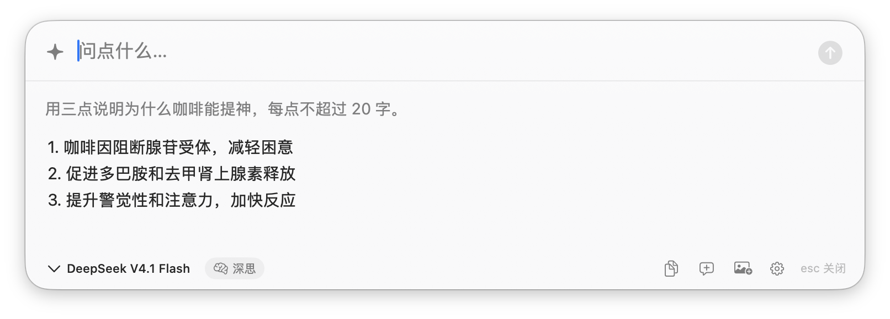

# 随手问 · QuickAsk

macOS 上按一下 **⌥ Space** 就能问一句的原生小窗答疑助手。不是 Electron，没有登录页，启动就是一个输入框。

> Windows 版在 [`windows/`](windows/)：WinForms + WebView2 的独立实现，不复用这里的 Swift 代码。



## 系统要求

macOS 14+（Sonoma 及以上）。`build.sh` 默认按 Apple Silicon（`arm64-apple-macos14.0`）编译；Intel 机器把脚本里的 target 改成 `x86_64-apple-macos14.0` 即可。

## 用它

| 操作 | 效果 |
| --- | --- |
| `⌥ Space` | 呼出 / 收起小窗（任意 App 里都生效） |
| `⏎` | 发送；回答流式吐出来 |
| `⇧⏎` | 换行 |
| `esc` | 关闭（正在生成则同时打断） |
| `⌘ N` / `⌘ K` | 新对话 |
| `⌘ V` | 剪贴板里的图片直接当问题附图 |
| 底部相机图标 | 框选截图提问（首次会要屏幕录制权限） |
| 点底部模型胶囊 | 一键换模型（DeepSeek 直连 / OpenCode Go 各家） |
| 菜单栏图标 | 打开、新对话、设置、开机自启、退出 |

小窗会跟着内容自动长高（最高 68% 屏高）然后滚动；窗口可以拖动；关掉再打开会保留上一轮对话，方便追问。

## 为什么不用 Cherry Studio + opencode go

同一句短问题、流式请求实测首字延迟：

| 线路 | 首字 | 整段 |
| --- | --- | --- |
| **DeepSeek 直连** `deepseek-flash` | **0.18s** | 1.16s |
| OpenCode Go `qwen3.8-flash` | 1.51s | 2.44s |
| OpenCode Go `glm-5.3-flash` | 2.44s | 2.68s |
| OpenCode Go `claude-haiku-5-5` | 2.54s | 3.37s |
| OpenCode Go `gemini-4-argon` | 3.22s | 3.74s |
| OpenCode Go `gpt-6-luna` | 3.31s | 3.88s |

Go 网关（`https://opencode.ai/inference/go/openai/v1`）要求带 `x-opencode-session` 请求头，且排队让首字延迟落在 1.5~5 秒——这基本就是"不够快"的来源，跟客户端关系不大。所以默认走 DeepSeek 直连（`deepseek-flash`，支持图片输入、1M 上下文），Go 的模型留在菜单里按需切。

## 问答记录

默认把每一次完整问答写成**一个独立 Markdown 文件**（路径可改，默认 `~/Documents/QuickAsk`），按天分文件夹：

```
~/Documents/QuickAsk/2026-11-15/16-32 工作区漂移是什么.md
```

*文件名 = 时间 + 问题前 14 字；正文是标题（问题）、时间/模型/耗时、完整回答*。目录是纯 Markdown，可以直接当文档库、知识库上下文用。

- 只在回答完整结束时写入；中途 `esc` 取消的不写
- 只记文字问答，不保存贴的图
- 关掉或换目录：菜单栏「设置 → 记录」

## 配置

`~/.config/quickask/config.json`（权限 600），也可以在菜单栏「设置…」里改：

```jsonc
{
  "baseURL": "https://api.deepseek.com",
  "apiKey": "sk-...",
  "model": "deepseek-flash",
  "extraHeaders": {},            // 例如 Go 网关的 x-opencode-session: "auto"
  "logEnabled": true,            // 是否记录问答
  "logDir": "~/Documents/QuickAsk",
  "supportsEffort": true,        // 是否发送 reasoning_effort
  "deepThink": false,            // 默认低思考，秒回；「深思」按钮切换
  "presets": [                   // 底部胶囊菜单里的模型列表
    { "name": "DeepSeek V4.1 Flash · 直连", "baseURL": "https://api.deepseek.com",
      "model": "deepseek-flash", "apiKey": "sk-...", "headers": {}, "supportsEffort": true },
    { "name": "Qwen3.8 Flash · Go", "baseURL": "https://opencode.ai/inference/go/openai/v1",
      "model": "qwen3.8-flash", "apiKey": "oc_...",
      "headers": { "x-opencode-session": "auto" }, "supportsEffort": false }
  ],
  "systemPrompt": "你是用户 Mac 上的随身答疑助手…"
}
```

任何 OpenAI 兼容接口都能用：改 `baseURL` + `model` + `apiKey` 即可（`https://xxx/v1` 会被自动补成 `/v1/chat/completions`）。

## 构建

```bash
./build.sh          # 产出 dist/随手问.app
cp -R dist/随手问.app ~/Applications/
```

需要 Xcode 命令行工具（`swiftc`）。源码在 `Sources/`：`App.swift` 菜单栏与生命周期、`PanelController.swift` 悬浮窗、`Views.swift` 界面与 Markdown、`ChatEngine.swift` 流式请求、`HotKey.swift` 全局热键、`Config.swift` 配置。

## 验证情况

- ✅ ⌥Space 热键注册成功（Carbon，不需要辅助功能权限），窗口弹出即拿到键盘焦点
- ✅ `⏎` 发送：合成回车事件后消息正常入列、回复落地
- ✅ `esc` 关闭：合成 Esc 后面板隐藏、进程留在菜单栏
- ✅ 多轮追问：第二问「三样里只保留最关键的一样」正确引用了第一问的三样物品
- ✅ 图片提问：把一张界面截图当图问，模型准确读出图里的文字和控件
- ⚠️ 真实按下的 ⌥Space 无法自动验证（系统不允许程序合成全局按键），手动按一次即可确认
- 修掉一个 bug：图片压缩用了 3 通道位图，`NSGraphicsContext` 返回 nil 导致崩溃，已改为带 alpha 的 4 通道并加 guard

## 卸载

菜单栏图标 → 退出；「设置…」里关掉开机自动启动；删除 `~/Applications/随手问.app` 与 `~/.config/quickask/`。

## 已知限制

- 全局热键固定 `⌥ Space`（Carbon 注册，不需要辅助功能权限）。
- 多显示器时出现在鼠标所在那块屏。
- 截图提问依赖系统「屏幕录制」授权；只贴图（⌘V）不需要。
- 界面中英混排、繁体/日文回答都没问题，但 UI 文案目前只有中文。
